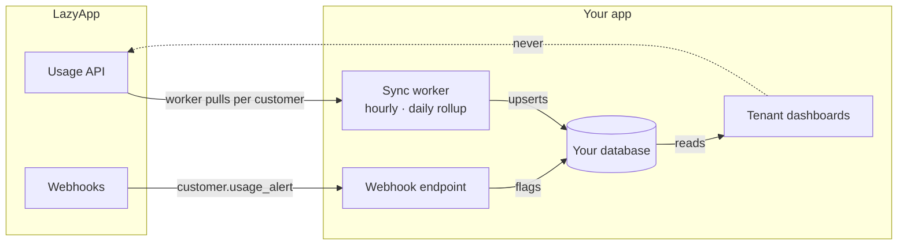

You want each of your customers to open a dashboard in your app and see *their* numbers: messages sent, what those messages cost at Meta's rates, and how close they are to a limit. LazyApp does not expose Instagram-style post engagement analytics — WhatsApp usage and billing are the metrics that matter here.

## Every usage read is already tenant-scoped

[`GET /v1/platform/customers/{customer}/usage`](/api-reference/platform/retrieve-customer-usage) returns that customer's workspace consumption for a billing period (`YYYY-MM`). Pass your platform key; no extra header is required because the customer is in the path.

```bash
curl "https://lazyapp.in/v1/platform/customers/cus_9f8b1c2d/usage?period=2026-09" \
  -H "Authorization: Bearer $LAZYAPP_API_KEY"
```

`period` defaults to the current month. The response is the workspace's usage analytics for that month, plus the customer's billing fields. Abridged:

```json
{
  "totals": {
    "messages": 1240,
    "freeMessages": 310,
    "paidMessages": 930,
    "metaCharges": "742.500000",
    "lazyappCharge": "0.000000",
    "totalCharge": "0.000000",
    "currency": "INR",
    "averageCostPerMessage": "0.000000"
  },
  "byCategory": [
    {
      "category": "marketing",
      "messages": 800,
      "metaCharges": "690.000000",
      "lazyappCharge": "0.000000",
      "totalCharge": "0.000000",
      "sharePct": 0
    }
  ],
  "daily": [],
  "byRegion": [],
  "byPhoneNumber": [],
  "byTemplate": [],
  "freeVsPaid": { "paidMessages": 930, "freeMessages": 310, "paidSharePct": 75, "freeSharePct": 25 },
  "spending_limit_cents": null,
  "wallet_balance_cents": 0,
  "billing_mode": "inherit"
}
```

The analytics keys (`totals`, `byCategory`, …) are camelCase; the customer billing fields are snake_case. Amounts in `totals` and the breakdowns are decimal strings in major units, six places.

This example is a customer-paid number, the default. `metaCharges` is what Meta's rates come to for these messages — Meta invoices the business for it directly. `totalCharge` is what LazyApp charged, and it is `0` because nothing passed through your wallet. On a [partner-managed](/platform/overview#who-pays-meta) number, `totalCharge` is Meta's rate, plus 5% when the WhatsApp account is not billed in USD and a further 5% for messages not sent through LazyApp.

<Note>
  `wholesale_total`, `marked_up_total` and `markup_bps` are no longer returned. LazyApp adds nothing to Meta's rates and platform customers have no markup, so there is nothing to mark up.
</Note>

The customer show payload also embeds a light `usage` summary for the current month: `period`, `messages` and `total_charge`.

List customers via [`GET /v1/platform/customers`](/api-reference/platform/list-customers) when you need a portfolio view.

## Don't proxy every dashboard render to the API

The tempting architecture — every widget on your customer's billing page calls LazyApp on load — burns your [per-key rate limit](/reference/rate-limits) and returns data that only changes when messages send.

The pattern that works: **serve dashboards from your own database, and refresh it with a background sync worker** (plus webhooks for alerts):



## The sync-worker pattern

One worker with a small concurrency cap, iterating your tenants:

| Tier | Cadence | Why |
| --- | --- | --- |
| Hot | Hourly | Current month totals for active tenants |
| Rollup | Daily | Archive completed months, catch missed hours |
| On demand | When the tenant opens billing | Optional single refresh if the last sync is stale |

On a `429`, wait and retry. A concurrency cap of around five keeps a worker well inside your per-key [rate limit](/reference/rate-limits).

Subscribe to [`customer.usage_alert`](/webhooks/events#platform) so a tenant approaching `usage_alert_cents` is flagged without polling.

## Show limits, not fake real-time

Surface what the API gives you:

| Field | Use |
| --- | --- |
| `totals.messages`, `freeVsPaid` | Primary chart |
| `totals.metaCharges`, `byCategory` | What the month costs at Meta's rates, by category. On a customer-paid number Meta bills this to the business |
| `totals.totalCharge` | What LazyApp charged for the month: `0` on a customer-paid number, Meta's rate plus the [partner-managed charges](/billing/wallets#platform-teams) on a partner-managed one. `inherit` debits your platform wallet, `prepaid` the customer's |
| `wallet_balance_cents` | Remaining customer wallet, for `prepaid` customers |
| `spending_limit_cents` | Cap on `totalCharge` before sends refuse with `402` |
| `customer.usage_alert` webhook | Proactive warning in your UI |

Whatever you charge your own customers is yours to calculate and invoice; LazyApp does not hold a price for it.

Sends refused for billing return `402` — handle that in the [messaging](/platform/messaging#billing-refusals) path so the tenant sees a clear reason.

## Checklist

- [ ] Dashboards read from your database; a worker fills usage
- [ ] Path-scoped `GET …/usage` per customer; portfolio list when needed
- [ ] `customer.usage_alert` webhook for threshold crossings
- [ ] Handle `402` on send as a billing state, not a transient error
- [ ] Don't invent social engagement charts — this product is WhatsApp usage

## Related

- [Build a platform](/platform/overview#how-platform-billing-works) — billing modes and lifecycle
- [Meta message billing](/billing/meta-message-billing) — how Meta charges for messages
- [Tenant messaging](/platform/messaging) — where `402` shows up on send
- [Rate limits](/reference/rate-limits) — per-key budget
- [Webhooks](/webhooks/events#platform) — usage alert event
